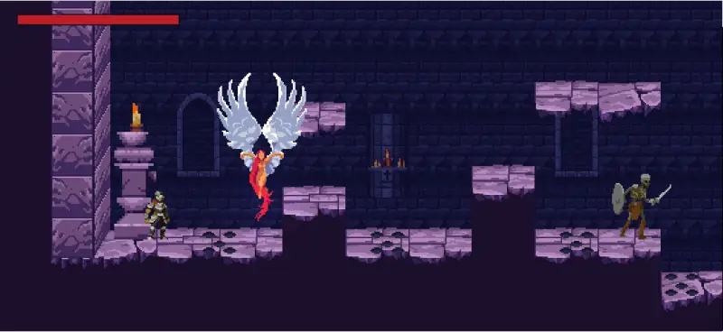

# Bastion

> 저주받은 성채에 들어간 기사가 타락한 수호자를 쓰러뜨리는 2D 횡스크롤 다크 판타지 액션 게임



Stage1 시작부터 보스 처치까지 38초 플레이 영상입니다 (소리 없음). 원본 MP4: [Docs/media/bastion-gameplay.mp4](Docs/media/bastion-gameplay.mp4)

- **장르**: 2D 횡스크롤 소울라이크 액션
- **플랫폼**: PC
- **엔진**: Unity 6 (6000.6.4f1), URP 2D
- **개발 기간**: 4주 (주 6시간)
- **목적**: 포트폴리오

기획 문서는 [Docs/GameDesign.md](Docs/GameDesign.md)에 있습니다. 설계와 구현, 개발 중 겪은 문제는 [Docs/DevelopmentGuide.md](Docs/DevelopmentGuide.md)에 정리했습니다.

## 주요 특징
- **이동**: 가감속 달리기, 가변 높이 점프, 더블점프, 코요테 타임, 점프 버퍼, 무적 구르기 (중력 적용, 공중 1회)
- **전투**: 입력 버퍼와 캔슬 시점이 있는 3타 콤보, 히트스톱, 카메라 쉐이크, 피격 플래시
- **적**: 방패로 정면 공격을 막는 Skeleton, 거리를 두고 화염구를 쏘는 Wizard
- **공격 예고**: 적과 보스가 공격하기 전 무기 주변으로 입자가 모여 회피 타이밍을 알려줌 (보스는 예비 동작 추가)
- **보스**: 낫 2연타, 가시 폭발, 소환 패턴과 체력 50%에서의 페이즈 전환 (속도 증가, 소환 추가)
- **함정**: 주기적으로 불기둥이 솟는 화염 분출구(예고 시 불티), 밀쳐내는 벽 피스톤 (그림 프레임과 판정이 일치)
- **흐름**: 타이틀 화면, 체크포인트(회복과 부활 지점), 사망·낙사 시 재시작, 보스 처치 시 클리어 후 타이틀로
- **아이템과 NPC**: 회복 물약, 말을 거는 수호령(대사는 ScriptableObject, 타자 효과, 대화 중 시간 정지)
- **UI**: 체력바(잔상), 보스 체력바, 한글 픽셀 폰트(Galmuri, TextMeshPro Dynamic), 일시정지 메뉴, 음량 설정(PlayerPrefs 저장)
- **사운드**: 배경음 페이드 전환, 이벤트 기반 효과음, 함정의 3D 위치 소리
- **구조**: 플레이어, 적, 보스가 공유하는 상태 머신, ScriptableObject 수치 데이터, 이벤트 기반 연출 분리
- **테스트**: PlayMode 테스트 44개 (이동, 경사로, 전투, 적 AI, 공격 예고, 보스, 함정, 체크포인트, 낙사, 회복, 대화, 일시정지, 설정 저장, 레벨 완주)

## 조작
| 키 | 게임패드 | 동작 |
|---|---|---|
| ← / → | 왼쪽 스틱, D패드 | 이동 |
| ↑ | A (South) | 점프 (길게 누르면 더 높이) |
| Z | X (West) | 공격 (연타 시 3타 콤보) |
| X | RB | 구르기 (무적, 공중 1회) |
| ↓ | Y (North) | NPC와 대화 |
| Esc | Start | 일시정지 |

## 설계 요약
| 영역 | 방식 |
|---|---|
| 상태 관리 | `StateMachine` + `IState`. 플레이어(지상/공중/대시/공격/피격/사망), 적(순찰/추적/공격/방어/피격/사망), 보스(대기/추적/베기/가시/소환/페이즈/사망) |
| 수치 | `PlayerMovementData`, `PlayerCombatData`, `EnemyData`, `BossData` (ScriptableObject) |
| 점프 | 높이와 정점 시간으로 중력과 초기 속도를 역산 |
| 근접 판정 | `AttackStep` 시간표에 따라 판정 구간에서 `OverlapBox`를 질의 (트리거 타이밍에 의존하지 않음) |
| 피해 | `IDamageable` / `Health` (무적 시간, 방어 필터, 이벤트) |
| 연출 | `HitStop`, `PlayerFeedback`(Cinemachine Impulse), `DamageFlash`. 게임 로직은 이벤트만 발생시킨다 |
| 애니메이션 | 이동은 Animator 파라미터, 공격/피격은 코드에서 `Animator.Play`. 로직은 애니메이션에 의존하지 않음 |
| 레벨 | 그림용 타일맵과 충돌용 타일맵을 분리 (바닥 그림의 울퉁불퉁한 윤곽에 걸리지 않도록) |
| 사운드 | 씬마다 하나인 `SoundManager`(배경음, 효과음). `HealthSounds`, `PlayerSounds`, `EnemySounds`, `BossSounds`가 로직 이벤트를 듣고 소리를 낸다 |
| 설정 | `GameSettings`(정적 클래스)가 기본값을 한 곳에 두고 PlayerPrefs에 저장, `Changed` 이벤트로 알림 |
| 카메라 | Cinemachine 3 (Position Composer, Confiner 2D, Pixel Perfect), URP Pixel Perfect Camera (384×216) |

## 프로젝트 구조
```
Assets/
├─ _Bastion/
│  ├─ Scripts/
│  │  ├─ Core/        상태 머신, 체크포인트, 게임 흐름, 설정, 패럴랙스
│  │  ├─ Player/      컨트롤러, 상태, 입력, 애니메이션, 연출
│  │  ├─ Combat/      Health, DamageInfo, AttackStep, HitboxQuery, HitStop, DamageFlash
│  │  ├─ Enemy/       EnemyController, MeleeEnemy, RangedEnemy, Projectile
│  │  ├─ Boss/        BossController, BossData, SummonMinion, BossArena
│  │  ├─ Hazards/     Trap, KillZone
│  │  ├─ Items/       HealthPickup
│  │  ├─ Dialogue/    DialogueData, DialogueBox, DialogueNpc
│  │  ├─ Audio/       SoundManager, 이벤트별 소리 컴포넌트
│  │  ├─ UI/          HealthBar, ScreenMessage, TitleMenu, PauseMenu, SettingsPanel
│  │  └─ Editor/      PixelSpriteImporter
│  ├─ Tests/PlayMode/ PlayMode 테스트
│  ├─ Data/           ScriptableObject 에셋
│  ├─ Prefabs/  Animations/  Art/  Audio/  Input/  Scenes/
└─ ThirdParty/        외부 에셋 원본 (수정하지 않음)
```

`ThirdParty` 아래의 PNG는 `PixelSpriteImporter`가 PPU 16, Point 필터, 무압축으로 자동 임포트하고 프레임 단위로 슬라이스합니다. 다시 슬라이스해도 스프라이트 ID가 유지되어 애니메이션 참조가 깨지지 않습니다.

### 레벨 편집
1. **Window > 2D > Tile Palette**에서 `Assets/_Bastion/Art/Palettes/Church` 팔레트를 열고 `Grid/Level` 타일맵에 칠합니다. 팔레트는 타일셋 원본과 같은 배치예요.
2. `Grid/Level`이나 `Grid/LevelFront`(벽 옆면)를 칠하거나 지우면 `Grid/Collision` 타일맵이 자동으로 다시 만들어집니다. 각 기둥의 맨 윗칸을 빼고 충돌을 깔아서 캐릭터가 바닥 윗면 안쪽을 밟습니다.
3. 경사로는 타일 충돌 위에 `Grid/Ramp` 폴리곤 충돌을 따로 둡니다.

Collision 자동 생성은 `Grid/Level`과 `Grid/LevelFront`만 봅니다. 떠 있는 발판 밑의 돌 조각(`Grid/LevelDecor`)과 벽 뒤에 깔린 바닥(`Grid/LevelUnder`)은 그림 전용이라 충돌이 없습니다. 팔레트 아래쪽에는 이 프로젝트에서 만든 파생 타일(발판 밑면, 바닥 끝 보정, 벽 블록, 벽 옆면)이 있어요. 자세한 제작 순서는 [개발 문서 10-4](Docs/DevelopmentGuide.md)에 있습니다.

## 실행 방법
1. 저장소를 클론합니다.
2. 아래 두 에셋은 재배포가 금지되어 있어 저장소에 포함되어 있지 않습니다. 각각 itch.io에서 받아 압축을 풉니다.
   - **Fantasy Knight**: [itch.io](https://aamatniekss.itch.io/fantasy-knight-free-pixelart-animated-character) → `Assets/ThirdParty/FreeKnight_v1/`
   - **Undead Executioner**: [itch.io](https://darkpixel-kronovi.itch.io/undead-executioner) → `Assets/ThirdParty/Undead executioner puppet/`
3. Unity 6000.6.4f1로 프로젝트를 열고 `Assets/_Bastion/Scenes/Title.unity`를 실행합니다. 스테이지만 확인하려면 `Stage1.unity`를 바로 실행해도 됩니다.

## 테스트
Unity Test Runner의 PlayMode 탭에서 실행하거나, Unity CLI로 실행합니다.

```bash
unity command run_tests --mode playmode --filter Bastion.Tests --async_tests true
```

## 크레딧
| 용도 | 에셋 | 제작자 | 라이선스 |
|---|---|---|---|
| 플레이어 | [Fantasy Knight](https://aamatniekss.itch.io/fantasy-knight-free-pixelart-animated-character) | aamatniekss | 무료, 상업 이용 가능, 재배포 금지 |
| 몬스터 | [Monsters Creatures Fantasy](https://luizmelo.itch.io/monsters-creatures-fantasy) | LuizMelo | CC0 |
| 몬스터 | [Monsters Creatures Fantasy 2](https://luizmelo.itch.io/monsters-creatures-fantasy-2) | LuizMelo | CC0 |
| 환경, Wizard, 체크포인트 | [GothicVania Church Pack](https://ansimuz.itch.io/gothicvania-church-pack) | ansimuz | CC0 |
| 환경 | [Gothicvania Bridge Expansion Pack 1](https://opengameart.org/content/gothicvania-bridge-expansion-pack-1) | ansimuz | CC0 |
| 보스 | [Undead Executioner](https://darkpixel-kronovi.itch.io/undead-executioner) | Kronovi- | 무료, 상업 이용 가능, 수정 가능, 재배포 금지 |
| 함정 | Animated Traps (Assets/ThirdParty/Traps) | Stealthix | CC0 |
| 한글 글꼴 | Galmuri (Assets/ThirdParty/Galmuri) | 이민서 | SIL Open Font License 1.1 |
| 회복 물약 그림, 효과음, 배경음 | 이 프로젝트에서 제작 | - | 프로젝트와 함께 배포 |
